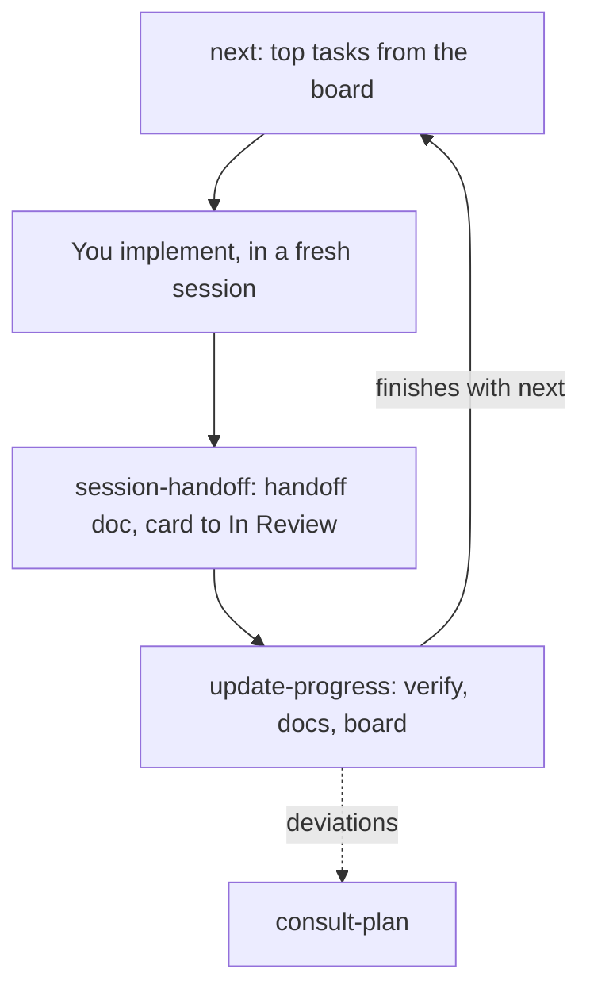

# kanban

These skills run a roadmap-driven workflow on **GitHub Issues + a GitHub Projects (v2) board**, so they work on any repo. It was first built for one project's own `docs/roadmap.md` / `docs/STATUS.md` / `docs/decisions.md` files.

Each skill folder has a `SKILL.md` (the prompt Claude follows) and a `README.md` (how to use it and how it works, for you).

## Prerequisite: the `project` OAuth scope

These skills use `gh project ...` commands, which need scopes your `gh` token may not have by default:

```bash
gh auth refresh -s project -s read:project
```

- Label mode (`status:*` labels) needs no `project` scope.
- Every skill here also needs `origin` on GitHub, and stops with a message if not.
- All `gh` calls target `origin`'s repo, and on a fork they ask before writing ([Target repo](next/BOARD.md#target-repo)).

Each skill checks for the scope and tells you if it's missing, but it's a one-time interactive step (opens a browser), so do it up front.

## The loop



Card status flow: todo → in-progress → in-review → done.

- **todo**: set explicitly by `gh project item-edit` when an issue is added — `item-add` alone leaves Status empty.
- **in-progress**: set by `pair`/`meta-orchestrator`, on branch create; guarded agents get read-only `gh`.
- **in-review**: set by `session-handoff`.
- **done**: set by `update-progress`, once verified and merged; unmerged stays in-review.
- Label-mode `status:*` labels are created on first use (`gh label create --color <hex> --force`, colors in [`next/BOARD.md`](next/BOARD.md)), not assumed to exist.

## The skills

- **[`next`](next/)** — what to work on, pulled from the board.
- **[`session-handoff`](session-handoff/)** — run when you're wrapping up an implementation session.
- **[`update-progress`](update-progress/)** — run in a fresh session afterward: verifies the handoff's claims, updates docs + the board + the issue.
- **[`consult-plan`](consult-plan/)** — grill a new idea or a deviation against the existing plan before it goes in.
  - `update-progress` calls this automatically if the handoff mentions deviations/innovations.
  - Call it directly to pitch something new.
- **[`divide`](divide/)** — split a task that's too big into session-sized issues.
- **[`kanban-setup`](kanban-setup/)** — bootstrap: creates the board if a repo doesn't have one yet.
  - It can backfill issues from whatever's already documented in the repo.
  - `mode=current` for open/planned work, `mode=retroactive` for already-done work, `mode=both`.

If a repo has no board yet, start with `kanban-setup`.

Handoffs and decisions these skills produce land in the repo's `skilleddocs/` folder (root README, "Where skills write"); the board holds the queue, `skilleddocs/` holds the record.
