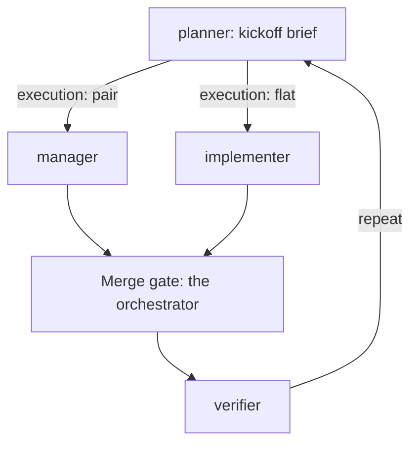

# meta-orchestrator

*`SKILL.md` is the prompt Claude follows; `SETUP.md` (first-run interview + every option) and `ROTATION.md` (handoff / resume) are loaded only when needed. This file is for you.*

## What it does

Works through a repo's backlog unattended. Claude becomes the **orchestrator**: it never implements, it loops `planner` → `manager` (or `implementer`) → merge gate → `verifier`, holds the merge gate itself (tests + CI green or no merge), logs every event to a ledger, and hands off to a fresh orchestrator session after a budget of merges. Almost every behaviour is a setting you pick on the first run.

## When to use

- "Go through the open issues and don't stop", "work through the board with subagents", "act as the orchestrator".
- "Resume" a previous orchestrator run.
- For one task, use [`pair`](../pair/) instead.

## How to invoke

```
/meta-orchestrator <repo path> [resume | reconfigure] [key=value ...]
```

- First run: setup interview (below), then the loop.
- `resume`: no questions; continues from `orchestrator-handoff.md`.
- `reconfigure`: re-run the interview on an existing run.
- `key=value` skips that question, e.g. `merge=ask execution=flat reports=end`.

## How it works

0. **Setup** ([`SETUP.md`](SETUP.md)). Read-only recon (contributing guide, `skilleddocs/`, branches, PRs, CI, merge style). Resolves defaults in layers: built-ins → your saved `~/.claude/orchestrator-defaults.md` → the repo's `AGENTS.md`/`CLAUDE.md` → arguments. Shows the resulting contract and asks **"Use these, or customize?"**. Customize walks four short rounds (multiple choice, recommended option first):

   | Round | You choose |
   |---|---|
   | Run shape | which issues, when to stop (queue empty / N merges / time box), `pair` vs `flat`, how many issues in parallel |
   | Control | merge `auto` / `ask` each time / `pr-only`, merge style, whether agents may answer planning questions for you, ask vs assume on calls with no written answer, which changes always pause for you (new deps, migrations, deletions, API or CI changes; billable always) |
   | Documentation | what gets written (ledger always; decisions register, per-issue handoffs, manager reports, CHANGELOG lines), whether docs are committed, report cadence (each handoff / every N merges / end / on request), Markdown or docx, ledger detail |
   | Models and pacing | implementer model, review model, handoff budget, push notifications |

   Writes **`skilleddocs/orchestrator/scope.md`** (a yaml block of every key), commits it, and offers to save your choices as personal defaults so the next repo starts from them.
1. **Agents.** `planner` → kickoff brief; `manager` (`execution: pair`) or `implementer` (`execution: flat`); `verifier`; mechanical chores go to `general-purpose` on `haiku`, never judgment or the merge gate. Each step is a fresh Agent call. Agents run code review inline (nested fan-out stalls). An **INTERIM** report is not a result, nor is a manager handback missing its Branch, Tests or Rounds section (asked once, then rerun).
2. **Loop:** `planner → manager | implementer → merge gate → verifier → repeat`; parallel issues each get their own worktree. With `parallel > 1`, [`lanes`](../lanes/) groups the queue into file-disjoint lanes, each working its issues in order; `/lanes` changes them mid-run.
3. **Merge gate (orchestrator only).** Tests/CI green for the head SHA; diff skimmed for scope creep, secrets, drift and anything on your pause list; push, then merge per your `merge` setting; worktree torn down links-first; ledger entry.
4. **Autonomy.** One retry per failure, then split or park, never loop. `decisions: assume` lets agents pick their recommendation for calls with no written answer (unlike `interview: answer`, which answers from the written plan) and log an open `A-n` for you to confirm; listed in every handoff and report. The `guard-git.py` hook blocks agents from pushing default or merging.
5. **Ledger.** Append-only `skilleddocs/orchestrator/ledger.md`, local timestamps, committed per entry (unless you chose uncommitted docs).
6. **Rotation** ([`ROTATION.md`](ROTATION.md)). After `handoff_budget` merges or a smart-zone warning (with lanes, once every in-flight lane has merged or parked): writes `orchestrator-handoff.md`, logs it, optionally runs a progress report, stops. `resume` picks up from there.
7. **Done** when every in-scope issue is closed or parked with a reason (or `stop` is reached), default is green, every merge has a verify entry.

## Flow



One issue's trip. With lanes, each lane runs this loop on its own issues; the merge gate stays serial.

## Design principles

- **The orchestrator never implements.** Its context stays free for decisions; a strong model there is worth more than anywhere else.
- **State lives in files, not context.** `scope.md` + ledger + git mean any fresh session can take over, so rotating is cheap and degrading is avoidable.
- **Ask once, up front.** Every preference is settled in setup and saved; the loop itself only stops for destructive or scope-changing calls.
- **Gates are binary.** Green tests and CI for the exact SHA, or no merge.

## Use cases

- Clearing a labelled backlog overnight with `merge=auto`.
- Running cautiously on a shared repo with `merge=pr-only`, so every change waits as a PR for you.
- Long runs split across days via `resume`, with a progress report at each handoff.

## Tips

- Run it once, customize, and save defaults; later repos then need one "use these" click.
- `merge=ask` is a good first run on a repo you care about; switch to `auto` once you trust the gate.
- Pair with branch protection on GitHub; the guard hook is a guardrail, not a sandbox.

## Example

First run on a repo (no `scope.md` yet), defaults otherwise, one loop shown
in full, then the rotation after the tenth merge:

```transcript
> /meta-orchestrator ~/code/myrepo merge=ask
⏺ No skilleddocs/orchestrator/scope.md yet: setup. Recon is read-only.
⏺ Bash(gh issue list --repo you/myrepo --state open)
  ⎿ 17  Add CSV export             size:M
    18  Paginate the audit log     size:S
    21  Pick a charting library    needs-design
⏺ Resolved contract (merge from your arguments; prefix, order, test command from recon):
    scope: all open issues
    exclude: gated / people / external-input
    execution: pair, parallel: 1
    merge: ask, merge_style: squash (the repo's style)
    interview: answer
    handoff_budget: 10
    prefix: feat, test: pytest
  Use these, or customize?
> Use these
⏺ Write(skilleddocs/orchestrator/scope.md)
⏺ Bash(git commit -m "docs(skilleddocs): orchestrator scope" && git push)
⏺ Save these as your defaults for future runs?
> no
⏺ Agent(subagent_type="planner", prompt="~/code/myrepo + skilleddocs/orchestrator/scope.md")
  ⎿ Issue: #17 Add CSV export (checklist: 3 items)
    Key files: src/export.py, tests/test_export.py
    Branch: feat/issue-17-csv-export
    Model: sonnet, well-specified
    Divide: no
⏺ Bash(git worktree add ../_worktrees/myrepo-issue-17-csv-export -b feat/issue-17-csv-export main)
⏺ Agent(subagent_type="manager", prompt="working directory: /home/you/code/_worktrees/myrepo-issue-17-csv-export; <the brief, verbatim>; prefix=feat; protected=main; max_rounds=3; never push or merge; code review inline, both axes, no reviewer subagents")
  ⎿ Branch: feat/issue-17-csv-export, head 4c1d2e9
    Tests: pytest, 124 passed (run by me)
    Findings: 1, fixed in round 2
    Rounds: 2 of 3
    Unfinished: none
⏺ Report saved to skilleddocs/orchestrator/reports/. Merge gate: running the tests myself.
⏺ Bash(cd ../_worktrees/myrepo-issue-17-csv-export && pytest -q)
  ⎿ 124 passed in 8.31s
⏺ Bash(git push -u origin feat/issue-17-csv-export && gh pr create --title "Add CSV export" --body "Adds CSV export. Closes #17")
  ⎿ https://github.com/you/myrepo/pull/40
⏺ PR #40 Add CSV export: 124 passed, diff in scope (src/export.py, tests/test_export.py). Merge?
> yes
⏺ Bash(gh pr merge 40 --squash --delete-branch && git pull --ff-only)
⏺ Bash(pair TEARDOWN.md step 1, Git Bash form: wt=/home/you/code/_worktrees/myrepo-issue-17-csv-export; main=/home/you/code/myrepo; reg=skilleddocs/decisions.md …)
  ⎿ moved skilleddocs/handoffs/2026-10-16-issue-17-csv-export.md
    appended A-4
⏺ Bash(rm "$wt/.venv"; left=$(git -C "$wt" status --porcelain --ignored --untracked-files=all -- skilleddocs); if [ -e "$wt/.venv" ] || [ -L "$wt/.venv" ] || [ -e "$wt/node_modules" ] || [ -L "$wt/node_modules" ] || [ -n "$left" ]; then echo "STOP: left in $wt:"; echo "$left"; else git -C "$main" worktree remove "$wt"; fi)
⏺ Bash(git commit -m "docs(skilleddocs): ledger 004" && git push)
⏺ Merged #17 as PR #40 (squash), 124 passed.
  Next: verify, then the planner picks again.
⏺ Agent(subagent_type="verifier", prompt="skilleddocs/orchestrator/reports/<#17 report>; interview=answer; review-done=yes")
  ⎿ Verified by: 124 passed · CI run 9876543210
    Decided for you: none
    Next: #18 Paginate the audit log
⏺ …nine more loops…
⏺ handoff_budget reached (10 merges). Wrote and pushed skilleddocs/orchestrator/orchestrator-handoff.md, ledger entry: handoff.
  Resume in a fresh session: /meta-orchestrator ~/code/myrepo resume
```

## Related

- Spawns [`planner`, `manager`, `implementer`, `verifier`](../agents/README.md).
- Uses [`pair`](../pair/)'s worktree pattern; kanban skills via the agents ([`next`](../kanban/next/), [`divide`](../kanban/divide/), [`update-progress`](../kanban/update-progress/), [`consult-plan`](../kanban/consult-plan/)).
- [`lanes`](../lanes/) sets and changes `parallel` + `lanes` in scope.md.
- [`progress-report`](../progress-report/) reads its ledger.
- Optional [`hooks/smartzone.py`](../hooks/smartzone.py) triggers an early rotation.

## Prereqs

`gh` (authenticated); the four agents installed (`scripts/install-skills.*`); a board, `status:*` labels, or a roadmap doc for `next` to read. Push notifications need the PushNotification tool.
