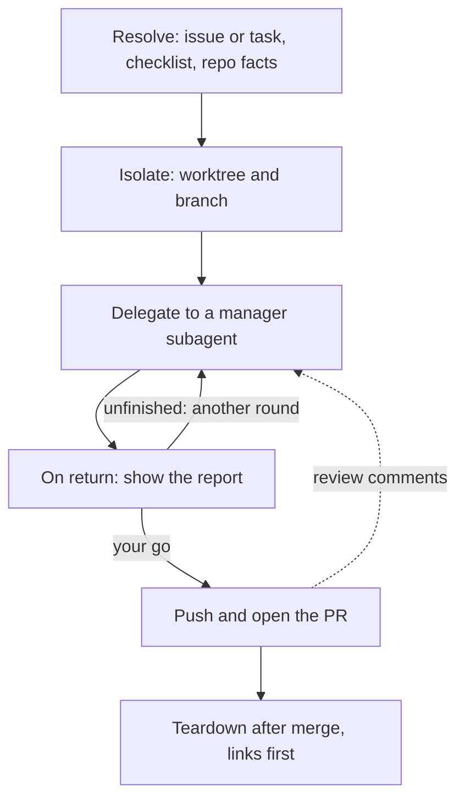

# pair

*`SKILL.md` is the prompt Claude follows; this file is for you.*

## What it does

Runs **one task** (a GitHub issue or free text) through a `manager` subagent in an isolated git worktree. The manager spawns and reviews an `implementer`, retrying up to 3 rounds. You stay in one interactive session; only your session pushes and opens the PR, at the end.

## When to use

- One task on any repo, including OSS forks with no kanban board.
- "Implement issue #n with a manager + implementer", "pair on this".
- For a whole backlog, use [`meta-orchestrator`](../meta-orchestrator/) instead.

## How to invoke

```
/pair <issue # | task text> [--no-worktree] [--push] [--model opus|sonnet]
```

- `--no-worktree` — new branch in the current checkout instead of a worktree.
- `--push` — push and open the PR without asking.
- `--model` — implementer model override (default: manager's choice, sonnet for mechanical work).

Model-invocable, so "pair on issue 12" also works.

## How it works

1. **Resolve the task.** Issue number → `gh issue view`; text → Claude writes a 3–6 item acceptance checklist. Collects default branch, branch prefix (from your `CLAUDE.md`, else `feat`), test command, `CONTRIBUTING.md`/`AGENTS.md`. On a fork (`upstream` remote): fetches upstream, fast-forwards the default branch, and checks every file/symbol the issue cites still exists.
2. **Isolate.** `git worktree add ../_worktrees/<repo>-<slug> -b <prefix>/<slug> <default>` (slug = `issue-<n>-<kebab-title>`). Reuses an existing worktree/branch if present. Deps (`node_modules`/`.venv`) are linked from the main checkout (`mklink /J` on Windows, `ln -s` elsewhere), not reinstalled. For an issue, your session then marks it started (card → In Progress, or `status:todo` → `status:in-progress`, creating that label first if missing; skipped with no board) and comments "Started on branch …"; a board error is reported, never blocking.
3. **Delegate.** One `Agent(subagent_type="manager")` call with working dir, task + checklist, verified/missing files, rules, implementer model, `max_rounds: 3`, "never push, merge, or open a PR". Not `fork`.
4. **On return.** Ignores a report titled **INTERIM** (implementer still running) and waits for the manager's next handback. Then shows the manager's report verbatim; reruns tests if the report is thin or risky; if `skilleddocs/HANDOFF.md` exists (unfinished), offers another round. Before pushing, checks `git diff --name-only <default>...HEAD` carries no `skilleddocs/HANDOFF.md` (nothing under `skilleddocs/` at all when handoffs are untracked, always the case on a fork; see [`TRACKING.md`](../handoff-auto/TRACKING.md)) and removes any hit in a commit. Pushes + `gh pr create … Closes #<n>` on `--push` or your go. Never merges. PR review feedback later → step 3 again in the same worktree.
5. **Print.** Branch, worktree path, PR URL (or "not pushed"), test result, rounds used, `skilleddocs/HANDOFF.md` path. Doesn't clean up the worktree until the PR merges — and then links-first (never a recursive delete through a linked `node_modules`/`.venv`), before `git worktree remove`.

Writes: a worktree + branch; commits (via agents); `skilleddocs/HANDOFF.md` in the worktree if unfinished (untracked unless the repo tracks `skilleddocs/`; never pushed).

## Flow



## Design principles

- **Only your session touches the remote.** The manager and implementer never push, merge or open a PR (the guard hook enforces it); push and PR happen in your session, on `--push` or your go. Nothing ever merges.
- **Isolation by worktree.** Each task gets its own worktree and branch, so your main checkout stays usable and the agents need no other isolation.
- **Implementation stays out of your context.** The manager owns briefing, review and retries; you see one report, verbatim.

## Use cases

- Implementing one issue on your own repo without a board or an orchestrator.
- Contributing to an OSS fork: it syncs upstream first and checks the files the issue names still exist.
- Addressing PR review comments later: rerun the delegate step in the same worktree with the comments as the task.
- A free-text task with no issue at all ("pair on adding a `--dry-run` flag").

## Tips

- Set your branch prefix in your `CLAUDE.md`; otherwise branches start with `feat/`.
- An **INTERIM** report means the implementer is still running; wait for the real one.
- Leave the worktree alone while the manager runs.
- Tear down only after the PR merges, and remove the `node_modules`/`.venv` link before `git worktree remove`: a recursive delete through the link wipes the main checkout's copy.
- Unfinished after 3 rounds? Accept the offer of another round; it restarts from `skilleddocs/HANDOFF.md`.

## Example

Issue #42 in a repo whose default branch is `main` and with no branch prefix
in `CLAUDE.md` (so `feat`). `--push` means no question before the push:

```transcript
> /pair 42 --push
⏺ Bash(gh issue view 42)
  ⎿ title:  Fix date parsing
    state:  OPEN
    Dates with a UTC offset ("2026-09-26T10:00:00+02:00") fail to parse.
⏺ Bash(git worktree add ../_worktrees/myrepo-issue-42-fix-date-parsing -b feat/issue-42-fix-date-parsing main)
  ⎿ Preparing worktree (new branch 'feat/issue-42-fix-date-parsing')
⏺ #42 is on the board: moved to In Progress, commented "Started on branch `feat/issue-42-fix-date-parsing`".
⏺ Agent(subagent_type="manager", prompt="working directory: /home/you/code/_worktrees/myrepo-issue-42-fix-date-parsing; task: #42 Fix date parsing + checklist; rules: prefix=feat, protected=main, test cmd=pytest; implementer model: your call; max_rounds: 3; never push, merge, or open a PR.")
  ⎿ Branch: feat/issue-42-fix-date-parsing, base 1a2b3c4, head 9f8e7d6
    Commits: 9f8e7d6 fix: parse dates with a UTC offset (#42)
    Tests: pytest, 118 passed; lint: none configured (run by me)
    Findings: none
    Rounds: 1 of 3
    Unfinished: none
    Manual steps for caller: push, open the PR
⏺ Bash(git -C ../_worktrees/myrepo-issue-42-fix-date-parsing diff --name-only main...HEAD)
  ⎿ src/dates.py
    tests/test_dates.py
⏺ Bash(git -C ../_worktrees/myrepo-issue-42-fix-date-parsing push -u origin feat/issue-42-fix-date-parsing)
⏺ Bash(gh pr create --head feat/issue-42-fix-date-parsing --title "Fix date parsing" --body "Parse dates with a UTC offset. Closes #42")
  ⎿ https://github.com/you/myrepo/pull/57
⏺ Branch feat/issue-42-fix-date-parsing, worktree ../_worktrees/myrepo-issue-42-fix-date-parsing,
  PR https://github.com/you/myrepo/pull/57, tests pytest 118/118, rounds 1/3, no HANDOFF.md.
  The worktree stays until the PR merges.
```

## Related

- Spawns the [`manager`](../agents/README.md#manager) agent, which spawns [`implementer`](../agents/README.md#implementer).
- [`meta-orchestrator`](../meta-orchestrator/) runs the same manager per issue in `execution: pair` mode.
- Needs `gh` and the agents installed.

## Prereqs

`gh`, authenticated. The [`manager`](../agents/README.md#manager) and [`implementer`](../agents/README.md#implementer) agents installed (the install scripts do this), with their guard-hook needs: Python 3.8+, and Git Bash on Windows.
