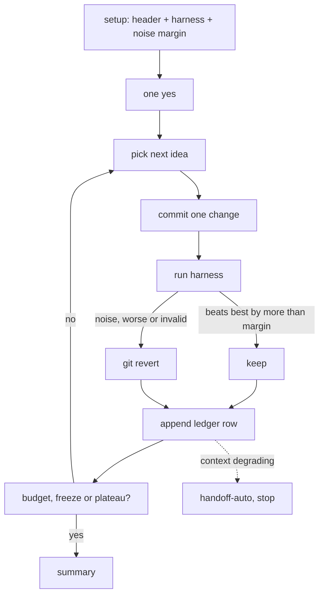

# score-loop

*`SKILL.md` is the prompt Claude follows; this file is for you.*

## What it does

Pushes one numeric score up (or down) unattended. Claude tries one idea per commit, measures it with a local harness that mirrors the real grader, keeps the commit only when it beats the best by more than the measured noise, and reverts it otherwise. Every experiment, kept or not, lands in a results ledger at `skilleddocs/experiments.md`.

## When to use

- "Improve this score", "hill-climb this metric", "optimize until it plateaus" or "until the deadline".
- Any task with a score you can rerun: a benchmark runtime, a model's validation accuracy, a bundle size, a leaderboard metric with a local grader.
- Not for unrepeatable or subjective scores (a one-shot review, "make it look nicer"): there is nothing to rerun.
- Not for a backlog of issues: that is [`meta-orchestrator`](../meta-orchestrator/).

## How to invoke

```
/score-loop [setup | resume | status | summary]
```

`setup` is the default. Model-invocable, so the trigger phrases above work too.

- `resume`: continue from `experiments.md` in a fresh session, no new setup gate.
- `status`: best score and commit, experiment counts, time to freeze and deadline, spend and quota left, next idea.
- `summary`: the ledger summary now.

## How it works

1. **Setup.** Fills a header in `skilleddocs/experiments.md`: metric and direction, grader and harness commands, submission path, official-submission quota, spend cap, deadline, noise margin, plateau K (default 5), parallel (default 1). Creates the branch `<prefix>score-loop/<slug>`.
2. **Harness first.** Builds a local harness if there isn't one: a correctness check plus the median of N runs. Runs the baseline N times to measure the noise margin, and calibrates against one official score (skipped when there is no official grader).
3. **One gate.** Shows the header and every outward action; after your one yes it runs unattended.
4. **Loop.** Picks the most promising idea from the Next ideas list, commits one change, runs the harness:
   - correctness fails → `git revert`, logged `invalid`, doesn't count toward K;
   - beats the best by more than the margin → kept;
   - within the margin → `git revert`, logged `noise`;
   - worse → `git revert`, logged `revert`.
5. **Stops** on the spend cap, at the deadline freeze (10% of the remaining time, at least 30 min: reruns the best, final submission on your yes), or after K experiments in a row without a keep. Then writes the summary.
6. **Rotation.** When its context degrades, writes a `handoff-auto` handoff pointing at `experiments.md` with `/score-loop resume`, and stops.

## Flow



## Design principles

- **Measure noise before chasing gains.** A commit only stays if it beats the best by more than the spread of repeated baseline runs, so the loop doesn't pile up lucky runs. A fast wrong answer never wins: a failed correctness check reverts regardless of score.
- **History matches the ledger.** Losers are undone with `git revert`, not reset, and ledger rows are never deleted, so every hypothesis stays visible in both.
- **Local is free, outward is gated.** Local runs need no approval; official submissions stay inside a quota you set, and anything paid goes through `spend-gate`.

## Use cases

- Cutting a benchmark's runtime before a deadline, with a correctness check that rejects broken speedups.
- Tuning a model's validation score against a competition's limited daily submissions.
- Shrinking a build artifact until ideas stop paying off.

## Tips

- Seed the Next ideas list yourself; the loop reads it fresh before every experiment, so you can append while it runs.
- A noisy grader means a wide margin and few keeps. Cut the noise at its source (fixed seeds, warm-up runs, an idle machine) rather than lowering the margin.
- `parallel` above 1 runs variants in separate worktrees, but graders that share a machine get noisier. Leave it at 1 unless the grader is remote or cheap.
- Set the quota to 0 if every official submission should ask you first.
- Ablation reruns (which kept commit really mattered) cost grader time, so they run only when you ask.

## Example

```
/score-loop make the parser benchmark faster, deadline Friday 18:00
```

Writes a harness that checks the parser output against fixtures and reports the median of 5 runs; baseline 412 ms, spread 9 ms, so the margin is 9 ms. You say yes to the header (quota 0, no spend). Experiment 1 (precompile the regexes) gives 371 ms and is kept; experiment 2 (bigger read buffer) gives 368 ms, inside the margin, and is reverted as `noise`; experiment 3 (skip validation) fails the correctness check and is reverted as `invalid`. After four more experiments without a keep it stops on plateau and appends a summary: one kept commit, -41 ms.

## Related

- [`spend-gate`](../spend-gate/): every paid submission or compute step.
- [`handoff-auto`](../handoff-auto/): the handoff written when context degrades; where `experiments.md` is committed follows its [`TRACKING.md`](../handoff-auto/TRACKING.md).
- [`pair`](../pair/): the same worktree-per-task pattern the parallel mode uses.
- [`sitrep`](../sitrep/): live status of the session around the loop.

## Prereqs

git, and a score you can compute locally. A `smartzone` hook helps it notice context degrading.
