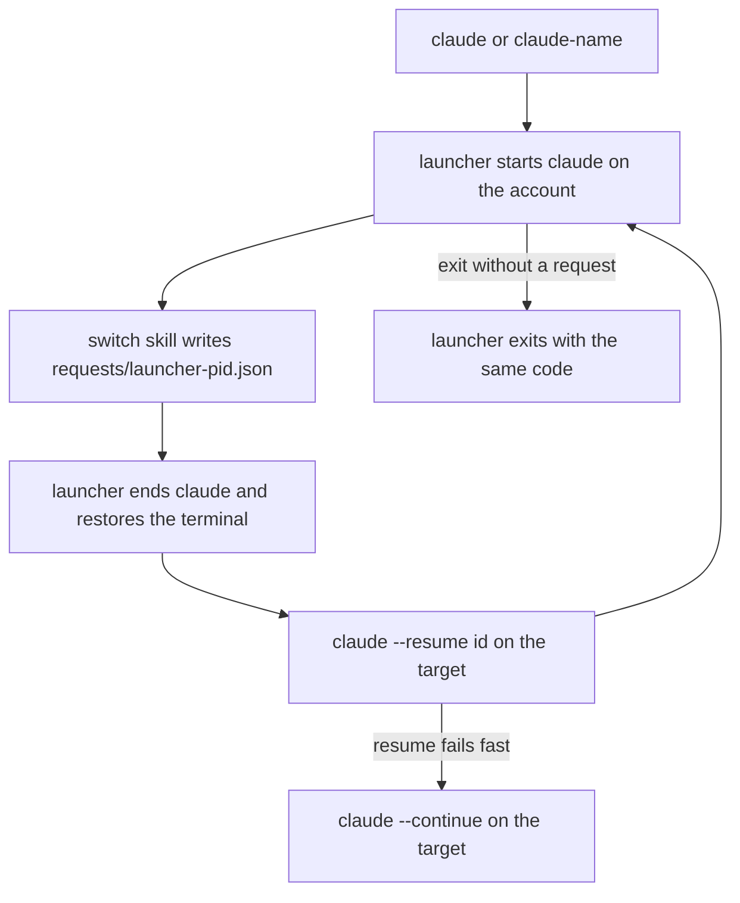

# switch

*`SKILL.md` is the prompt Claude follows; this file is for you.*

## What it does

Runs several Claude Code accounts side by side, each with its own config
dir, and moves a live conversation from one to another. Start Claude with
`claude` (the account you used last) or `claude-<name>`; inside a session,
`/switch` closes it and reopens the same conversation on your previous
account, `/switch <name>` on a named one. `/switch add|remove|rename|list`
manages the accounts; new ones share skills, settings and history with
the first.

## When to use

- One account hits its usage limit mid-task and you want to carry on with
  the same conversation on another.
- You keep a work and a personal login and want one command per account
  instead of exporting `CLAUDE_CONFIG_DIR` by hand.
- You want a new account that sees the same skills, settings and
  conversation history as your first one.

## How to invoke

One-time setup from a shell (use the installed copy, e.g.
`~/.claude/skills/switch/scripts/claude_switch.py`). On Windows type
`python` (or `py`) wherever these examples say `python3`: there
`python3` is usually the Microsoft Store stub.

```
python3 claude_switch.py setup --account main=~/.claude --account alt=~/.claude-alt
```

Already have `~/.claude-<name>` dirs? `python3 claude_switch.py migrate`
(Windows: `python claude_switch.py migrate`) registers them (and
`~/.claude` as `main`) without touching their contents.

Then, in a new shell, `claude` or `claude-alt`, and inside a session:

```
/switch [name]
/switch add <name> [--dir DIR]
/switch remove <name> [--delete-dir]
/switch rename <old> <new>
/switch list
```

User-invoked only; Claude never switches on its own.

## How it works

1. **Setup** (`claude_switch.py setup`) registers each `--account NAME=DIR`
   in `~/.claude-switch/accounts.json` (name, dir, colour, theme,
   last-used; written atomically) and copies the script there; the
   wrappers call that copy, so updating or uninstalling the skill
   doesn't break your shells. No `--account` on a first run registers
   `main` = `~/.claude`. It then writes a block between
   `# >>> claude-switch >>>` markers into each shell profile it finds
   (bash, zsh, fish, PowerShell 5.1 and 7) and `claude.cmd` /
   `claude-<name>.cmd` shims for cmd, shows the unified diff and writes
   only after `y`. Rerunning replaces only its own block.
2. **Launcher.** `claude` and `claude-<name>` run `claude_switch.py run`,
   which starts the real `claude` with that account's `CLAUDE_CONFIG_DIR`
   (unset for `~/.claude`, so `~/.claude.json` stays where Claude expects
   it), `CLAUDE_SWITCH_LAUNCHER=<its pid>` and the account name, and
   records the account as last used.
3. **`/switch`** runs `claude_switch.py request [name] --session <this
   session id>`. With no name it picks the account this launcher came
   from, else the most recently used other one. It writes
   `~/.claude-switch/requests/<launcher pid>.json` and nothing else;
   unknown names list the accounts, a session not started by the launcher
   gets the setup steps.
4. **Relaunch.** The launcher sees its own request file, ends Claude
   (Windows: the whole process tree, MCP servers included), restores the
   terminal (raw mode, alt screen, bracketed paste, cursor) and starts the
   target account with `--resume <session id>`. If that exits with an
   error within 10 s it prints one line and uses `--continue`. Other
   args you started Claude with (e.g. `--model`) are not carried across
   a switch; only `--resume` / `--continue` are passed.
5. When Claude exits without a request, the launcher exits with its code.
   Ctrl+C goes to Claude, never the launcher.
6. **`add <name>`** creates `~/.claude-<name>` (or `--dir`) and links the
   first account's `skills/`, `agents/`, `commands/`, `plugins/`,
   `projects/` (a missing one is created empty there first),
   `settings.json` and `CLAUDE.md` into it. `.credentials.json` and
   `.claude.json` stay per account, so Claude asks the new one to log in.
   Dirs are junctions on Windows and symlinks elsewhere; files are
   symlinks. An item already in the new dir is left as is. It picks a
   free colour, regenerates the shell files setup wrote and, inside a
   launched session, moves this conversation to the new account.
7. **`remove <name>`** unregisters it and regenerates the shell files;
   the dir stays unless you pass `--delete-dir` and confirm. The skill
   always shows the `--dry-run` plan first: which links get unlinked
   (their shared targets are kept) and what gets deleted. Deleting
   unlinks every link and junction first and never walks through one.
   It refuses the account you're on, the last one, and the first one
   while others link into it.
8. **`rename <old> <new>`** changes the name and the shell commands;
   the dir is not moved. **`list`** shows each account's colour, dir,
   last use and which one you're on. **`migrate`** registers `~/.claude`
   and every `~/.claude-<name>` dir holding `.credentials.json`,
   `.claude.json` or `projects/`; it only reads them and links nothing.

## Flow



## Design principles

- **One launcher per terminal, one request file per launcher.** Each
  launcher only watches `requests/<its pid>.json`, so two terminals
  switching at once never pick up each other's request (the older
  approach shared a single file and climbed the process tree).
- **Shells stay thin.** Every shell gets a generated one-line wrapper per
  account that calls the same stdlib Python launcher with an absolute
  interpreter path; all logic lives in one script you can test.
- **Show before writing.** Setup prints the exact profile diff and asks;
  later account commands only rewrite the marked block in the files setup
  recorded, and print each path they change.
- **Deleting never follows a link.** Shared history lives behind every
  account's `projects/` link, so a delete that recursed through one would
  wipe it for all accounts.

## Use cases

- Out of usage on one account: `/switch` and keep going in the same
  conversation on the other.
- Two terminals, two accounts, both switching back and forth all day.
- A new login that should see your skills and history from the start:
  `/switch add work`, log in, carry on.
- A cmd or PowerShell user who wants the same `claude-<name>` commands as
  a bash user.

## Tips

- Resuming needs the conversation's transcript under the target's config
  dir. Accounts made with `add` share `projects/`, so it is there; for
  accounts registered by `setup` or `migrate` it isn't, and a resume
  falls back to `--continue` (the target's own latest conversation).
- Windows without Developer Mode can't make file symlinks: `add`
  hardlinks `settings.json` and `CLAUDE.md` instead (or copies across
  drives) and warns. Claude rewrites `settings.json` by replacing the
  file, which splits a hardlink into a separate copy; turn on Developer
  Mode (Settings, System, For developers) before `add` to keep it shared.
- bash on macOS reads `~/.bash_profile` for login shells; source
  `~/.bashrc` from it, or pass `--profile bash=~/.bash_profile`.
- cmd: put `~/.claude-switch/bin` first on `PATH`. The launcher never
  picks its own shims when it looks for the real `claude`.
- `--profile SHELL=PATH` (repeatable; `bash`, `zsh`, `fish`, `powershell`,
  `pwsh`, `cmd`) writes only those targets, for a non-default profile.
- Rerun setup after moving Python: wrappers embed its absolute path.
- PowerShell with execution policy `Restricted` (the Windows default)
  never loads your profile, so `claude-<name>` is missing: run
  `Set-ExecutionPolicy -Scope CurrentUser RemoteSigned` once.
- Setup refuses a profile that isn't UTF-8 (PowerShell 5.1's
  `Set-Content` writes ANSI): save it as UTF-8 and rerun.
- An old `~/.claude-switch` *file* from earlier scripts is moved aside to
  `~/.claude-switch.stale-<time>`.

## Example

```
/switch
```

```
switching to 'alt': this session ends now and resumes there.
>> claude-switch: main -> alt
```

The same conversation reopens on `alt`. `/switch nope` instead prints
`unknown account 'nope'. accounts: main (current), alt` and does nothing.

## Related

- [`session-handoff`](../kanban/session-handoff/README.md): when the
  conversation is too long to carry over, hand off instead of switching.
- [`sitrep`](../sitrep/README.md): check what was running after a switch.

## Prereqs

Python 3.8+ (stdlib only) and Claude Code on `PATH`. Run `setup` once.
