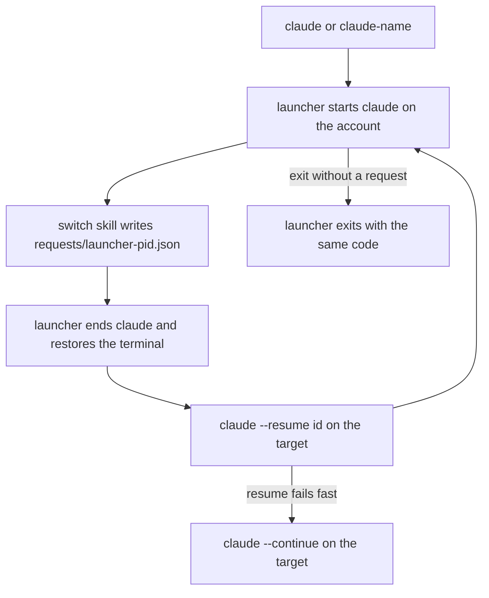

# switch

*`SKILL.md` is the prompt Claude follows; this file is for you.*

## What it does

Runs several Claude Code accounts side by side, each with its own config
dir, and moves a live conversation from one to another. Start Claude with
`claude` (the account you used last) or `claude-<name>`; inside a session,
`/switch` closes it and reopens the same conversation on your previous
account, `/switch <name>` on a named one. `/switch add|remove|rename|list`
manages the accounts; new ones share skills, settings and history with
the first. Before each switch it prints what stays with the old account
(artifacts, routines) and what ends or pauses (Remote Control, running
subagents, background commands); it never asks. A statusline shows
which account you're on and how much of its session and weekly limits
is used, and warns you near the limit with the account that has the
most room left.

## When to use

- One account hits its usage limit mid-task and you want to carry on with
  the same conversation on another.
- You keep a work and a personal login and want one command per account
  instead of exporting `CLAUDE_CONFIG_DIR` by hand.
- You want a new account that sees the same skills, settings and
  conversation history as your first one.

## How to invoke

One-time setup from a shell (use the installed copy, e.g.
`~/.claude/skills/switch/scripts/claude_switch.py`). On Windows type
`python` (or `py`) wherever these examples say `python3`: there
`python3` is usually the Microsoft Store stub.

```
python3 claude_switch.py setup --account main=~/.claude --account alt=~/.claude-alt
```

Already have `~/.claude-<name>` dirs? `python3 claude_switch.py migrate`
(Windows: `python claude_switch.py migrate`) registers them (and
`~/.claude` as `main`) without touching their contents.

Then, in a new shell, `claude` or `claude-alt`, and inside a session:

```
/switch [name]
/switch add <name> [--dir DIR]
/switch remove <name> [--delete-dir]
/switch rename <old> <new>
/switch list
/switch theme <name> [dark|light|...|-]
```

User-invoked only; Claude never switches on its own. To take the
statusline and hook back out of `settings.json`:
`python3 claude_switch.py setup --uninstall`.

## How it works

1. **Setup** (`claude_switch.py setup`) registers each `--account NAME=DIR`
   in `~/.claude-switch/accounts.json` (name, dir, colour, theme,
   last-used; written atomically) and copies the script there; the
   wrappers call that copy, so updating or uninstalling the skill
   doesn't break your shells. No `--account` on a first run registers
   `main` = `~/.claude`. It then writes a block between
   `# >>> claude-switch >>>` markers into each shell profile it finds
   (bash, zsh, fish, PowerShell 5.1 and 7) and `claude.cmd` /
   `claude-<name>.cmd` shims for cmd, shows the unified diff and writes
   only after `y`. Rerunning replaces only its own block.
2. **Launcher.** `claude` and `claude-<name>` run `claude_switch.py run`,
   which starts the real `claude` with that account's `CLAUDE_CONFIG_DIR`
   (unset for `~/.claude`, so `~/.claude.json` stays where Claude expects
   it), `CLAUDE_SWITCH_LAUNCHER=<its pid>` and the account name, and
   records the account as last used.
3. **`/switch`** runs `claude_switch.py request [name] --session <this
   session id>`. With no name it picks the account this launcher came
   from, else the most recently used other one. It prints the pre-switch
   notes (see "What follows the account"), writes a resume note to
   `~/.claude-switch/requests/<launcher pid>.note.md` and the request to
   `requests/<launcher pid>.json` (target, session, the transcript's
   absolute path). A trailing `yes` (`/switch work yes`) is ignored.
   Unknown names list the accounts, a session not started by the
   launcher gets the setup steps.
4. **Relaunch.** The launcher sees its own request file, ends Claude
   (Windows: the whole process tree, MCP servers included), restores the
   terminal (raw mode, alt screen, bracketed paste, cursor) and starts the
   target account with `--resume <session id>`, or `--resume <absolute
   transcript path>` when the target's `projects/` doesn't hold the
   session (an account with its own, unshared history). The switch line is
   followed by the resume note's path. If that exits with an
   error within 10 s it prints one line and uses `--continue`. Other
   args you started Claude with (e.g. `--model`) are not carried across
   a switch; only `--resume` / `--continue` are passed.
5. When Claude exits without a request, the launcher exits with its code.
   Ctrl+C goes to Claude, never the launcher.
6. **`add <name>`** creates `~/.claude-<name>` (or `--dir`) and links the
   first account's `skills/`, `agents/`, `commands/`, `plugins/`,
   `projects/` (a missing one is created empty there first),
   `settings.json` and `CLAUDE.md` into it. `.credentials.json` and
   `.claude.json` stay per account, so Claude asks the new one to log in.
   Dirs are junctions on Windows and symlinks elsewhere; files are
   symlinks. An item already in the new dir is left as is. It picks a
   free colour, regenerates the shell files setup wrote and, inside a
   launched session, moves this conversation to the new account.
7. **`remove <name>`** unregisters it and regenerates the shell files;
   the dir stays unless you pass `--delete-dir` and confirm. The skill
   always shows the `--dry-run` plan first: which links get unlinked
   (their shared targets are kept) and what gets deleted. Deleting
   unlinks every link and junction first and never walks through one.
   It refuses the account you're on, the last one, and the first one
   while others link into it.
8. **`rename <old> <new>`** changes the name and the shell commands;
   the dir is not moved. **`list`** shows each account's colour, dir,
   last use and which one you're on. **`migrate`** registers `~/.claude`
   and every `~/.claude-<name>` dir holding `.credentials.json`,
   `.claude.json` or `projects/`; it links nothing, and once setup has
   run it adds the statusline and hook to each one's `settings.json`.
   Renaming the account you're on is fine: the launcher looks it up by
   its dir at the next switch.
9. **Statusline.** Setup also writes a `statusLine` (refreshed every 60
   s), and the hook below, into every account's `settings.json`; one
   linked between accounts is written once, and an account whose dir
   doesn't exist yet is skipped (rerun setup after its first login).
   `add` and `migrate` do the same for a new account with its own file;
   `remove` takes them out of a file no other account uses. It prints the account name in its colour, then
   `session 42% · 2h13m left  week 18% · 4d6h left` from Claude Code's
   `rate_limits.five_hour` / `seven_day` fields (`-` until Claude reports
   them; they only exist for Pro and Max plans). A statusline you had
   before is never overwritten: setup records it per file in the registry, the
   new one runs it with the same input and puts its output on the same
   line, and `setup --uninstall` puts it back. Settings are backed up to
   `~/.claude-switch/backups/` and written in place, so a linked
   `settings.json` stays linked.
10. **Usage guard.** The statusline caches each account's last seen
    usage in `~/.claude-switch/usage/<account>.json`. With two or more
    accounts, a `UserPromptSubmit` hook warns once when the account
    crosses 90% and once at 97% in a window: `main at 91%: run /switch
    alt`, naming the account with the most room (a window past its reset
    counts as empty).
11. **`/switch` at 100%.** The same hook catches a typed `/switch` or
    `/switch <name>`, writes the launcher's request and blocks the
    prompt, so the switch makes no API call and works on an account that
    is out of usage. Claude Code passes a typed skill line to this hook
    as typed, before the skill expands (hooks reference, section
    "UserPromptSubmit input"; blocking per "UserPromptSubmit decision
    control"). `add`, `remove`, `rename`, `list` and `theme` still go
    through the skill.
12. **Theme and title.** `/switch theme <name> <theme>` gives an account
    its own Claude theme: the launcher passes it as
    `--settings '{"theme":...}'`, merged with a `--settings` you passed
    yourself (yours wins on the same key). It also sets the terminal tab
    title to `claude: <name>` at each start and switch, and prints the
    switch line in the target account's colour.

Launcher-only: the switch itself, the theme, the tab title and the
rename pickup need Claude started with `claude` or `claude-<name>`.
The statusline and the guard work in any session on a registered
account; `/switch` outside a launcher prints the setup steps.

## Flow



## What follows the account

Login, settings and transcripts belong to a config dir; some features
belong to the claude.ai account that is logged in there. Before every
switch `/switch` prints what each of them does; none of it stops the
switch:

- **Remote Control** ends with the old Claude process. When it was on,
  `/switch` says so; run `/remote-control` on the target if you want it
  there.
- **Subagents**. A subagent whose transcript (under the
  session's `subagents/` folder) has no final reply yet, or changed in
  the last 10 minutes, counts as running. The switch pauses it; after
  the relaunch, `SendMessage` to its id resumes it with its history.
  Explore and Plan agents are one-shot and can't be resumed.
- **Background Bash commands and monitors** end with the old process
  and are not resumed.
- **Artifacts published in this session and routines** stay on the old
  account; republishing an artifact from the new one needs edit rights
  to it.
- **claude.ai connectors and MCP OAuth** follow the login: run `/mcp`
  on the target to connect them there. The **Chrome extension** must be
  signed into the target's organisation.

Each switch also writes a resume note, `~/.claude-switch/requests/<launcher pid>.note.md`
(session, working dir, branch, last commit, live subagent ids and what
to do about them); the launcher prints its path under the switch line
and deletes it when it exits. Point the resumed conversation at it if
you need it.

## Design principles

- **One launcher per terminal, one request file per launcher.** Each
  launcher only watches `requests/<its pid>.json`, so two terminals
  switching at once never pick up each other's request (the older
  approach shared a single file and climbed the process tree).
- **Shells stay thin.** Every shell gets a generated one-line wrapper per
  account that calls the same stdlib Python launcher with an absolute
  interpreter path; all logic lives in one script you can test.
- **Show before writing.** Setup prints the exact profile diff and asks;
  later account commands only rewrite the marked block in the files setup
  recorded, and print each path they change.
- **Wrap, never replace.** Setup adds one statusline and one hook to
  `settings.json`, keeps a statusline you had and runs it, and
  `--uninstall` removes only what it added.
- **Deleting never follows a link.** Shared history lives behind every
  account's `projects/` link, so a delete that recursed through one would
  wipe it for all accounts.

## Use cases

- Out of usage on one account: `/switch` and keep going in the same
  conversation on the other; the hook does it without an API call.
- The guard says `main at 91%: run /switch alt` before you run out.
- Two terminals, two accounts, both switching back and forth all day.
- A new login that should see your skills and history from the start:
  `/switch add work`, log in, carry on.
- A cmd or PowerShell user who wants the same `claude-<name>` commands as
  a bash user.

## Tips

- Accounts made with `add` share `projects/`, so the target resumes the
  session by id. For accounts registered by `setup` or `migrate` it
  isn't there, so the launcher passes the transcript's absolute path
  instead (a Windows path with spaces as its short 8.3 name); if that
  resume fails too, it falls back to `--continue` (the target's own
  latest conversation).
- Windows without Developer Mode can't make file symlinks: `add`
  hardlinks `settings.json` and `CLAUDE.md` instead (or copies across
  drives) and warns. Claude rewrites `settings.json` by replacing the
  file, which splits a hardlink into a separate copy; turn on Developer
  Mode (Settings, System, For developers) before `add` to keep it shared.
- bash on macOS reads `~/.bash_profile` for login shells; source
  `~/.bashrc` from it, or pass `--profile bash=~/.bash_profile`.
- cmd: put `~/.claude-switch/bin` first on `PATH`. The launcher never
  picks its own shims when it looks for the real `claude`.
- `--profile SHELL=PATH` (repeatable; `bash`, `zsh`, `fish`, `powershell`,
  `pwsh`, `cmd`) writes only those targets, for a non-default profile.
- Rerun setup after moving Python (wrappers embed its absolute path) or
  updating the skill (refreshes the script copy the wrappers call).
- PowerShell with execution policy `Restricted` (the Windows default)
  never loads your profile, so `claude-<name>` is missing: run
  `Set-ExecutionPolicy -Scope CurrentUser RemoteSigned` once.
- Setup refuses a profile that isn't UTF-8 (PowerShell 5.1's
  `Set-Content` writes ANSI): save it as UTF-8 and rerun.
- An old `~/.claude-switch` *file* from earlier scripts is moved aside to
  `~/.claude-switch.stale-<time>`.
- On Windows Claude Code runs the statusline and hook commands through
  Git Bash when it is installed, else PowerShell (statusline docs,
  "Windows configuration"). Setup writes them with forward slashes and
  short (8.3) names for paths with spaces, so the same line works in
  both.
- An account with its own `settings.json` (registered by `setup` or
  `migrate`, or an existing file `add` left as is) gets the statusline
  and the hook in that file too, so `/switch` from it needs no API call
  either.
- Theme names are Claude Code's: `dark`, `light`, `dark-daltonized`,
  `light-daltonized`, `dark-ansi`, `light-ansi`. `-` clears it.

## Example

```
/switch
```

```
before switching main -> alt:
  dies: background Bash commands and monitors, if any (Explore/Plan agents are one-shot)
  stays on main: artifacts published this session (republishing needs edit rights), routines
  follows the login: run /mcp on alt for claude.ai connectors and MCP OAuth; the Chrome extension must be signed into alt's org
switching to 'alt': this session ends now and resumes there.
>> claude-switch: main -> alt
   resume note: ~/.claude-switch/requests/41236.note.md
```

The same conversation reopens on `alt`. `/switch nope` instead prints
`unknown account 'nope'. accounts: main (current), alt` and does nothing.

## Related

- [`session-handoff`](../kanban/session-handoff/README.md): when the
  conversation is too long to carry over, hand off instead of switching.
- [`sitrep`](../sitrep/README.md): check what was running after a switch.

## Prereqs

Python 3.8+ (stdlib only) and Claude Code on `PATH`. Run `setup` once.
