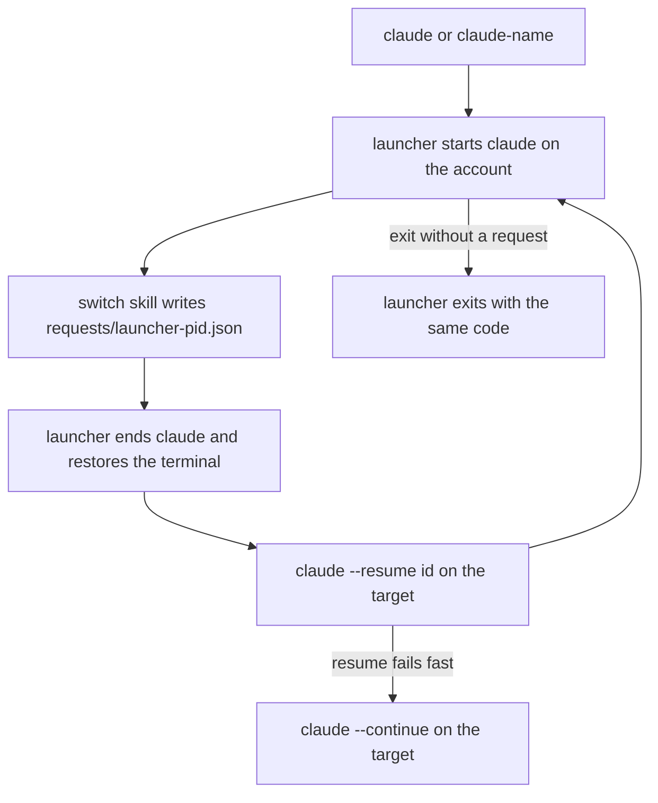

# switch

*`SKILL.md` is the prompt Claude follows; this file is for you.*

## What it does

Runs several Claude Code accounts side by side, each with its own config
dir, and moves a live conversation from one to another. Start Claude with
`claude` (the account you used last) or `claude-<name>`; inside a session,
`/switch` closes it and reopens the same conversation on your previous
account, `/switch <name>` on a named one.

## When to use

- One account hits its usage limit mid-task and you want to carry on with
  the same conversation on another.
- You keep a work and a personal login and want one command per account
  instead of exporting `CLAUDE_CONFIG_DIR` by hand.
- Not for sharing skills, settings or history between accounts: part 1
  only switches config dirs. Linking shared items and add/remove/rename
  come in part 2 (#211).

## How to invoke

One-time setup from a shell (use the installed copy, e.g.
`~/.claude/skills/switch/scripts/claude_switch.py`):

```
python3 claude_switch.py setup --account main=~/.claude --account alt=~/.claude-alt
```

Then, in a new shell, `claude` or `claude-alt`, and inside a session:

```
/switch [name]
```

User-invoked only; Claude never switches on its own.

## How it works

1. **Setup** (`claude_switch.py setup`) registers each `--account NAME=DIR`
   in `~/.claude-switch/accounts.json` (name, dir, colour, theme,
   last-used; written atomically). No `--account` on a first run registers
   `main` = `~/.claude`. It then writes a block between
   `# >>> claude-switch >>>` markers into each shell profile it finds
   (bash, zsh, fish, PowerShell 5.1 and 7) and `claude.cmd` /
   `claude-<name>.cmd` shims for cmd, shows the unified diff and writes
   only after `y`. Rerunning replaces only its own block.
2. **Launcher.** `claude` and `claude-<name>` run `claude_switch.py run`,
   which starts the real `claude` with that account's `CLAUDE_CONFIG_DIR`
   (unset for `~/.claude`, so `~/.claude.json` stays where Claude expects
   it), `CLAUDE_SWITCH_LAUNCHER=<its pid>` and the account name, and
   records the account as last used.
3. **`/switch`** runs `claude_switch.py request [name] --session <this
   session id>`. With no name it picks the account this launcher came
   from, else the most recently used other one. It writes
   `~/.claude-switch/requests/<launcher pid>.json` and nothing else;
   unknown names list the accounts, a session not started by the launcher
   gets the setup steps.
4. **Relaunch.** The launcher sees its own request file, ends Claude
   (Windows: the whole process tree, MCP servers included), restores the
   terminal (raw mode, alt screen, bracketed paste, cursor) and starts the
   target account with `--resume <session id>`. If that exits with an
   error within 10 s it prints one line and uses `--continue`.
5. When Claude exits without a request, the launcher exits with its code.
   Ctrl+C goes to Claude, never the launcher.

## Flow



## Design principles

- **One launcher per terminal, one request file per launcher.** Each
  launcher only watches `requests/<its pid>.json`, so two terminals
  switching at once never pick up each other's request (the older
  approach shared a single file and climbed the process tree).
- **Shells stay thin.** Every shell gets a generated one-line wrapper per
  account that calls the same stdlib Python launcher with an absolute
  interpreter path; all logic lives in one script you can test.
- **Show before writing.** Setup prints the exact profile diff and asks.

## Use cases

- Out of usage on one account: `/switch` and keep going in the same
  conversation on the other.
- Two terminals, two accounts, both switching back and forth all day.
- A cmd or PowerShell user who wants the same `claude-<name>` commands as
  a bash user.

## Tips

- Resuming needs the conversation's transcript under the target's config
  dir. Until shared items are linked (part 2), a resume across accounts
  usually fails and falls back to `--continue` (the target's own latest
  conversation in that folder); symlink `projects/` yourself meanwhile.
- bash on macOS reads `~/.bash_profile` for login shells; source
  `~/.bashrc` from it, or pass `--profile bash=~/.bash_profile`.
- cmd: put `~/.claude-switch/bin` first on `PATH`. The launcher never
  picks its own shims when it looks for the real `claude`.
- `--profile SHELL=PATH` (repeatable; `bash`, `zsh`, `fish`, `powershell`,
  `pwsh`, `cmd`) writes only those targets, for a non-default profile.
- Rerun setup after moving the skill or Python: wrappers embed both
  absolute paths.
- An old `~/.claude-switch` *file* from earlier scripts is moved aside to
  `~/.claude-switch.stale-<time>`.

## Example

```
/switch
```

```
switching to 'alt': this session ends now and resumes there.
>> claude-switch: main -> alt
```

The same conversation reopens on `alt`. `/switch nope` instead prints
`unknown account 'nope'. accounts: main (current), alt` and does nothing.

## Related

- [`session-handoff`](../kanban/session-handoff/README.md): when the
  conversation is too long to carry over, hand off instead of switching.
- [`sitrep`](../sitrep/README.md): check what was running after a switch.

## Prereqs

Python 3.8+ (stdlib only) and Claude Code on `PATH`. Run `setup` once.
